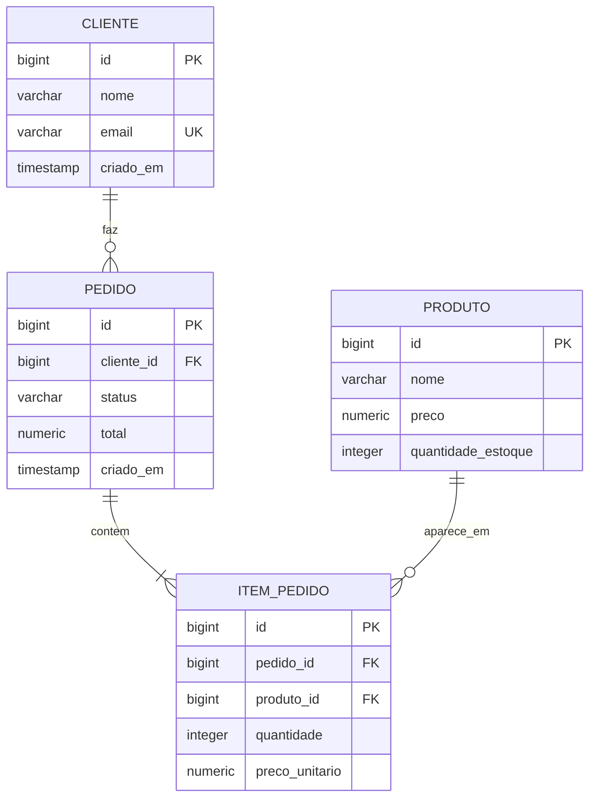

# mini-erp

API REST de um mini-ERP para controle de clientes, produtos, estoque e pedidos. Feita com Java e Spring Boot como projeto de portfólio, evoluindo a ideia de um projeto anterior (`estoque-api`).

O foco está nas regras de negócio de um pedido: baixa de estoque, consistência em caso de erro e proteção contra duas compras simultâneas do mesmo item.

## Tecnologias

- Java 21 e Spring Boot 4
- Spring Data JPA (Hibernate) e Bean Validation
- PostgreSQL 16, com migrations do Flyway
- Docker Compose para o banco de dados
- JUnit, MockMvc e Testcontainers para os testes
- Swagger (Springdoc) para documentar e testar a API

## O que a API faz

| Módulo | Endpoints |
|---|---|
| Clientes | `POST /clientes`, `GET /clientes`, `GET /clientes/{id}` |
| Produtos | `POST /produtos`, `GET /produtos`, `GET /produtos/{id}` |
| Pedidos | `POST /pedidos`, `GET /pedidos`, `GET /pedidos/{id}`, `PATCH /pedidos/{id}/cancelar` |

### Regras de negócio

- **Tudo ou nada:** se qualquer item do pedido falhar (por exemplo, por estoque insuficiente), a transação desfaz o pedido inteiro e não altera nenhum estoque.
- **Sem estoque negativo:** o pedido é recusado quando a quantidade solicitada passa do estoque disponível.
- **Proteção contra concorrência:** o estoque é lido com lock pessimista, e os itens são processados em ordem de `produtoId` para evitar vendas duplicadas da última unidade e deadlocks entre pedidos simultâneos.
- **Preço histórico:** cada item guarda o preço do momento da compra, então mudar o preço do produto depois não altera pedidos antigos.
- **Cancelamento:** devolve o estoque dos itens e não pode ser feito duas vezes.
- **E-mail único:** não é possível cadastrar dois clientes com o mesmo e-mail.

### Respostas de erro

Os erros seguem o formato `ProblemDetail` (RFC 7807):

| Situação | Status |
|---|---|
| Dados inválidos | `400`, com o mapa `erros` indicando cada campo |
| Recurso não encontrado | `404` |
| Regra de negócio violada (estoque insuficiente, e-mail repetido, pedido já cancelado) | `422` |

## Modelo do banco



O schema é versionado com Flyway em `src/main/resources/db/migration`.

## Como rodar

Pré-requisitos: Java 21 e Docker.

```bash
# 1. Sobe o PostgreSQL
docker compose up -d

# 2. Roda a aplicação
./mvnw spring-boot:run
```

No Windows (PowerShell), use `.\mvnw.cmd spring-boot:run`.

A documentação interativa fica em [http://localhost:8080/swagger-ui.html](http://localhost:8080/swagger-ui.html).

## Testes

```bash
./mvnw test
```

Os testes de integração sobem um PostgreSQL real com Testcontainers, então o Docker precisa estar rodando. A suíte cobre as regras de estoque, as validações e os códigos HTTP de cada módulo, além de um teste de concorrência com duas threads disputando a última unidade de um produto.

## Estrutura

```
src/main/java/com/nicolli/mini_erp
├── cliente    # entidade, DTOs, repository, service e controller
├── produto
├── pedido
└── common     # exceções de negócio e tratamento de erros
```

## Próximos passos

- Autenticação com Spring Security e JWT
- Dockerfile para a aplicação e pipeline no GitHub Actions
- Relatórios de vendas em Python lendo o banco
- Deploy na AWS

## Autora

Nicolli, estudante de Análise e Desenvolvimento de Sistemas.

[GitHub](https://github.com/nicollidandaracardoso) · [LinkedIn](https://linkedin.com/in/nicollidandara)
